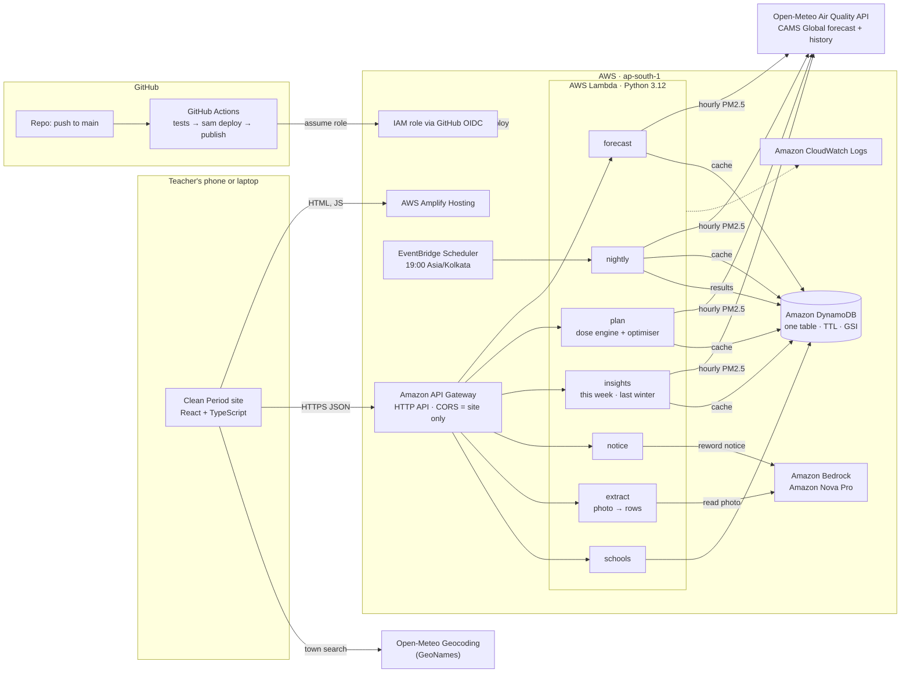

# Architecture

Clean Period runs on AWS in **ap-south-1 (Mumbai)**. Everything is serverless and
defined as code in [`infra/template.yaml`](../infra/template.yaml) (AWS SAM).

**Design rule:** code decides the plan, AI only handles text. The dose engine and
optimiser are plain Python with no AI and no AWS calls (`backend/core/`). Amazon
Bedrock reads timetable photos and words the parent notice, and code checks
both before anything reaches a user.

## Diagram

## Request flows

### Make tomorrow's plan: `POST /plan`
1. The site sends the school's location, the time slots and each class's periods.
2. `plan` fetches the hourly PM2.5 forecast from Open-Meteo. The response is
   cached in DynamoDB for 3 hours per ~1 km point.
3. The dose engine computes `PM2.5 × exposure factor × breathing rate × minutes`
   for every period.
4. If every school hour is above 120 µg/m³, all outdoor periods become indoor
   activity. Otherwise the optimiser swaps movable periods to the lowest total
   dose, keeping the rules: a teacher is in one class at a time, the ground
   holds at most N classes, fixed periods never move.
5. The response carries the before and after timetables, doses, the hourly air,
   CPCB categories, sources and the assumptions in English and Hindi.

### Parent notice: `POST /notice`
1. Code turns the plan into a few facts (date, moves, % cut, dirtiest and
   cleanest hour) and writes a template notice in Hindi and English.
2. Amazon Nova Pro (Bedrock Converse API) rewords it for tone.
3. Code accepts the AI text only if every number and time in it is in the facts
   and every moved period is still there. Otherwise the template is returned
   with the reason. A 15-second timeout keeps the request inside API Gateway's
   limit.

### Read a timetable photo: `POST /extract`
1. The site shrinks the photo in the browser (at most 1600 px, JPEG) and sends it.
2. Amazon Nova Pro reads it into rows per weekday.
3. Code keeps only rows with valid 24-hour times, an end after the start and a
   subject; guesses missing activities from the subject (PE, games, assembly,
   break, yoga); counts dropped rows. The photo is not stored.
4. The teacher picks the day and checks every row before planning.

### This week and last winter: `POST /outlook`, `POST /backtest`
- `outlook` fetches a 7-day forecast and plans each coming school day with the
  same timetable; days the forecast does not cover are marked, not guessed. The
  day with the cleanest school-hours air is marked for outdoor events.
- `backtest` fetches last winter's real hourly PM2.5 for the location (cached 30
  days) and replays every weekday with the original and the optimised order.

### Nightly plan
1. A school is saved with `POST /schools`; the secret edit key is returned once
   and only its SHA-256 hash is stored.
2. EventBridge Scheduler invokes `nightly` at 19:00 Asia/Kolkata.
3. For each saved school it plans tomorrow, writes the template notice and
   stores the result (30-day TTL). One failing school is stored as an error and
   the run continues; a summary goes to CloudWatch.

## Data model (one DynamoDB table)

| Item | Partition key | Sort key | Notes |
|---|---|---|---|
| Forecast cache | `FORECAST#lat#lon#tz[#7d]` | `LATEST` | 3-hour expiry |
| History cache | `HISTORY#lat#lon#tz#start#end` | `LATEST` | 30-day expiry |
| School | `SCHOOL#id` | `META` | timetable JSON, edit-key hash; GSI1 lists schools |
| Nightly result | `SCHOOL#id` | `RESULT#date` | plan + notice, 30-day TTL |

## Deployment and security

- **Infrastructure as code:** one SAM template, one `sam deploy`.
- **Continuous deployment:** every push to `main` runs GitHub Actions: 257
  backend tests and a frontend type check, then `sam deploy`, then the site is
  built with the live API URL and published to Amplify.
- **No stored AWS keys:** GitHub Actions signs in with OIDC to a role that trusts
  only `main` of this repository, identified by owner and repo ID.
- **Least privilege per function:** only `notice` and `extract` may call Bedrock,
  and only Amazon Nova Pro; only the data functions may use the table.
- **CORS** allows only the Amplify site.
- **Why Amazon Nova Pro:** Claude models on Bedrock are sold through AWS
  Marketplace, and our account could not complete that subscription. Nova is
  sold by AWS directly and reads both images and Hindi well.
